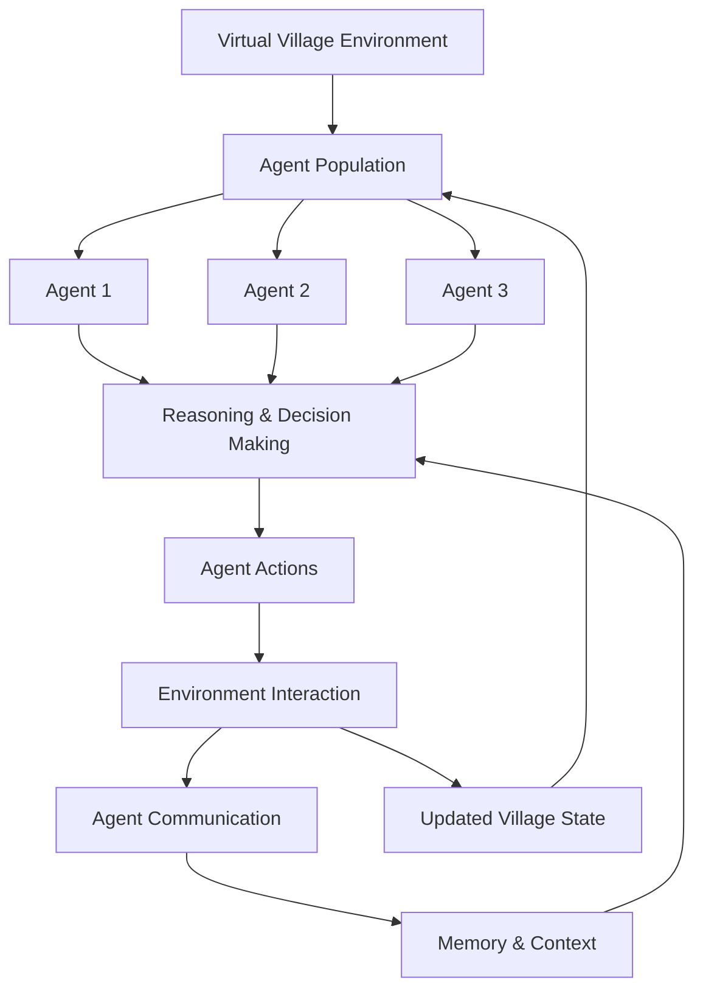

\<div align="center">

# 🌍 Village Verse — AI Agents

### An Autonomous AI Village Where Intelligent Agents Live, Interact & Evolve

**Exploring multi-agent intelligence, autonomous decision-making, social interactions, and emergent behaviour in a shared virtual world.**


\


\<br/>

[🚀 Explore Repository](https://github.com/patilakshay111/Village_Verse_AI_agents)
[🐛 Report Issue](https://github.com/patilakshay111/Village_Verse_AI_agents/issues/new)
[⭐ Star This Project](https://github.com/patilakshay111/Village_Verse_AI_agents)

\</div>

---

## 🧠 About the Project

**Village Verse** is an experimental AI simulation project exploring what happens when multiple autonomous AI agents share a common virtual environment.

Instead of interacting with a single chatbot, imagine an entire village populated by intelligent agents — each capable of making decisions, interacting with other agents, responding to their environment, and participating in a shared simulation.

The project explores the intersection of:

- Autonomous AI agents
- Multi-agent systems and orchestration
- Large Language Models (LLMs)
- Agent communication and collaboration
- Persistent memory and contextual reasoning
- Emergent behaviour in simulated environments

The central idea is simple:

> What happens when AI agents are given an environment, individual identities, and the freedom to interact?

## ✨ Project Vision

Village Verse aims to explore a simulated environment where AI agents can operate as independent participants rather than simply responding to predefined user prompts.

### 🤖 Autonomous Agents

Explore agents that can reason, make decisions, and perform actions within a shared environment.

### 💬 Agent-to-Agent Communication

Enable interactions between agents and explore how conversations influence subsequent decisions.

### 🧠 Memory & Context

Explore how agents can retain relevant experiences and use previous interactions to inform future behaviour.

### 🌐 Shared Virtual Environment

Provide a common world where agents can interact with other agents and their surroundings.

### 🔄 Emergent Behaviour

Observe how individual decisions and interactions can produce unexpected collective behaviours.

### 🧩 Multi-Agent Orchestration

Explore how multiple intelligent agents can operate together within a coordinated simulation.

## 🏗️ Conceptual Architecture

The project can be understood through the following conceptual workflow:



*This diagram illustrates the project's conceptual direction, not a verified implementation diagram.*

## 🔬 What Makes This Interesting?

Traditional AI applications often follow a request-response pattern:

`User → Prompt → LLM → Response`

A multi-agent simulation introduces a more dynamic system:

`Agent → Decision → Action → Interaction → Observation → New Decision`

This creates opportunities to investigate:

- How agents coordinate without a central controller.
- How relationships and interactions influence decisions.
- How memory changes agent behaviour over time.
- How collaboration and competition emerge.
- How individual agent behaviour affects the larger environment.

## 🛠️ Technology & Concepts

The project explores concepts from the following areas. Refer to the implementation and dependency files for the technologies currently used.

| Area                    | Concepts                           |
| ----------------------- | ---------------------------------- |
| Artificial Intelligence | Large Language Models              |
| Agent Systems           | Autonomous and multi-agent systems |
| Reasoning               | Contextual decision-making         |
| Memory                  | Conversation and experience memory |
| Communication           | Agent-to-agent interaction         |
| Simulation              | Shared virtual environments        |
| Orchestration           | Multi-agent coordination           |

## 🚀 Getting Started

### 1. Clone the repository

```bash
git clone https://github.com/patilakshay111/Village_Verse_AI_agents.git
```

### 2. Enter the project directory

```bash
cd Village_Verse_AI_agents
```

### 3. Set up your Python environment

If the project uses Python:

```bash
python -m venv venv
```

Activate the environment:

**Windows**

```bash
venv\Scripts\activate
```

**Linux / macOS**

```bash
source venv/bin/activate
```

### 4. Install dependencies

If the repository contains a `requirements.txt` file:

```bash
pip install -r requirements.txt
```

### 5. Configure environment variables

If the application requires API credentials, configure them using the project's environment configuration. Never commit API keys or secrets to GitHub.

### 6. Run the application

Check the repository's entry-point file and project instructions for the correct execution command.

> **Note:** The setup instructions above are a general starting point. The exact dependencies, environment variables, and run command depend on the implementation in the repository.

## 📸 Screenshots & Demo

Visual demonstrations of the village simulation will help visitors understand the project immediately.

Add screenshots or GIFs in an `assets/` directory and update the paths below.

```text
Village_Verse_AI_agents/
│
├── assets/
│   ├── village-overview.png
│   ├── agent-interaction.png
│   └── simulation-demo.gif
│
└── README.md
```

Example display:

```markdown


```

## 🗺️ Roadmap

The following are potential development directions, not claims that these features are already implemented.

- [ ] Expand autonomous agent behaviours.
- [ ] Introduce richer agent personalities and identities.
- [ ] Improve persistent memory across interactions.
- [ ] Develop more sophisticated agent communication.
- [ ] Introduce collaborative and competitive scenarios.
- [ ] Build a more interactive village environment.
- [ ] Add agent activity monitoring and visualisation.
- [ ] Evaluate agent behaviour and long-term consistency.

## 🌱 Research & Learning Goals

Village Verse is also an exploration of several important questions in agentic AI:

1. Can autonomous agents develop consistent behaviour over repeated interactions?
2. How does memory influence an agent's decisions?
3. Can multiple agents collaborate to solve problems?
4. What kinds of collective behaviours emerge from simple individual rules?
5. How can we measure the quality and consistency of autonomous agent behaviour?

## 🤝 Contributing

Contributions, ideas, and experiments are welcome.

1. Fork this repository.
2. Create a feature branch.
3. Make your changes.
4. Submit a pull request.

For bugs or suggestions, open an issue:

[Create a GitHub Issue](https://github.com/patilakshay111/Village_Verse_AI_agents/issues/new)

## 👨‍💻 Author

**Akshay Patil**

AI Engineer | Agentic AI | Generative AI | Multi-Agent Systems

- GitHub: [@patilakshay111](https://github.com/patilakshay111)

## ⭐ Support the Project

If you find this project interesting, consider giving it a star on GitHub.

It helps support experimentation and development in autonomous AI systems.

\<div align="center">


**Built to explore the future of autonomous AI societies.**

\</div>

---

\<div align="center">
\<sub>Village Verse • An experimental exploration of multi-agent intelligence\</sub>
\</div>


Multi-agent Indian village simulation (Anandgaon).

## One-click start (Windows)

Double-click **`Run-VillageVerse.bat`** in this folder.

- Starts **one** server on port **8000** (API + built UI together)
- Opens **http://127.0.0.1:8000** in your browser
- No separate frontend window or Node.js needed after the UI is built once

Requires **Ollama** running for simulation ticks (`ollama serve`).

Optional dev mode (hot reload): run `Run-VillageVerse.bat`, then `Run-VillageVerse-Dev.bat` and open http://127.0.0.1:5173

## One-click stop

Double-click **`Stop-VillageVerse.bat`**, or close the two terminal windows titled **VillageVerse API** and **VillageVerse UI**.

## Manual start

See [backend/README.md](backend/README.md) and [frontend/README.md](frontend/README.md).
